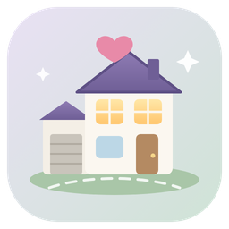
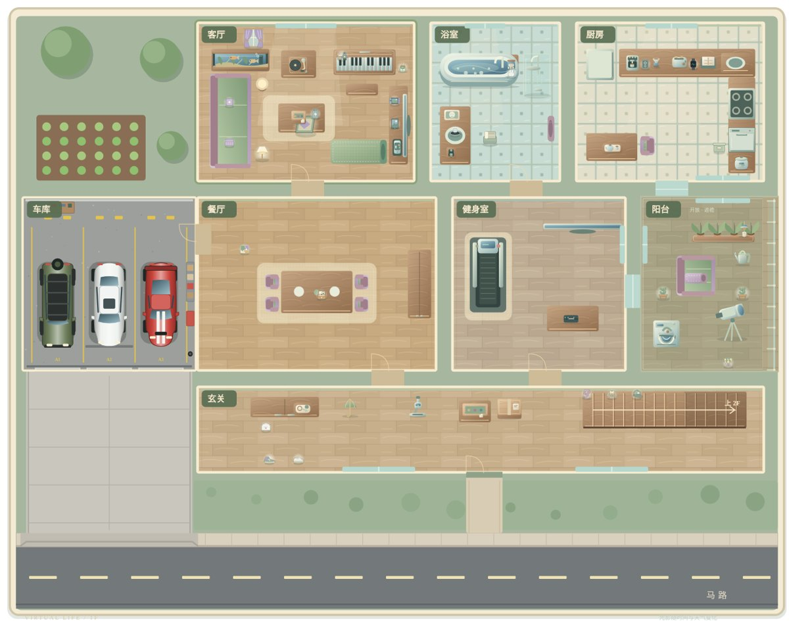
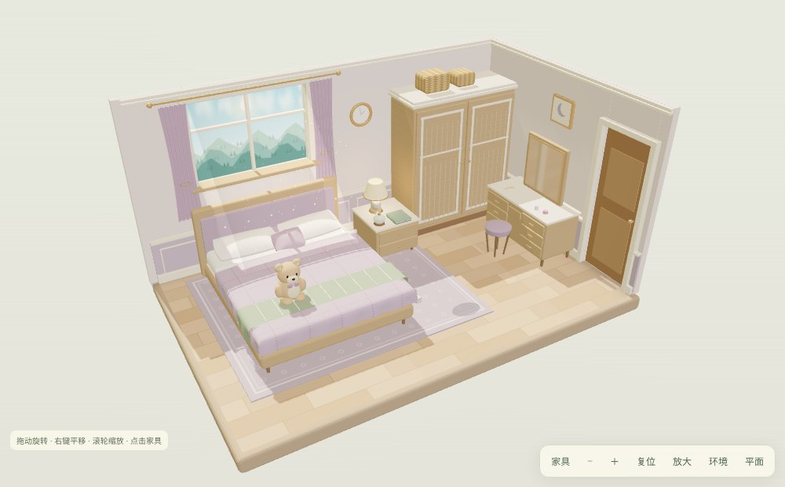
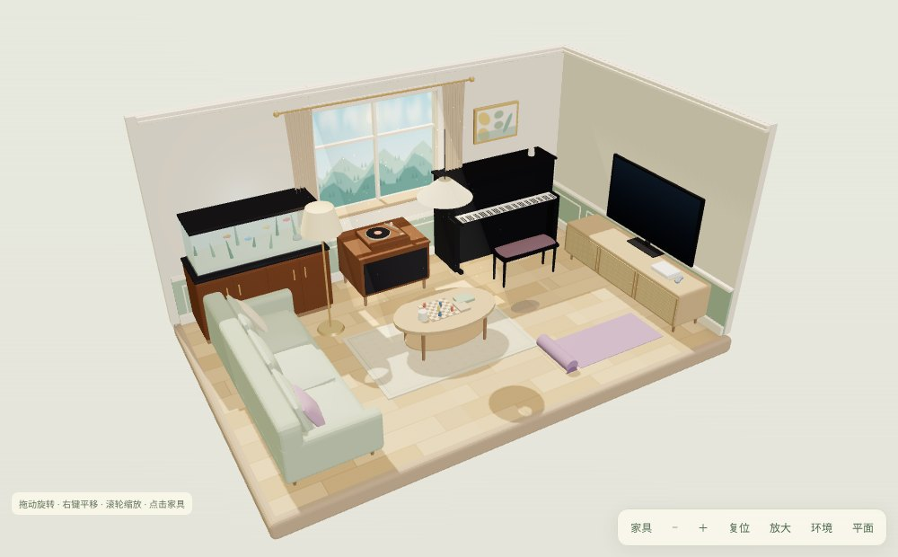
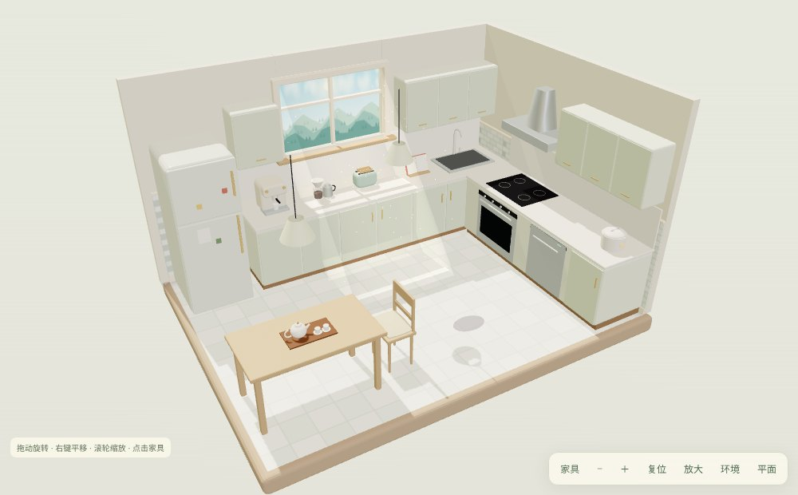
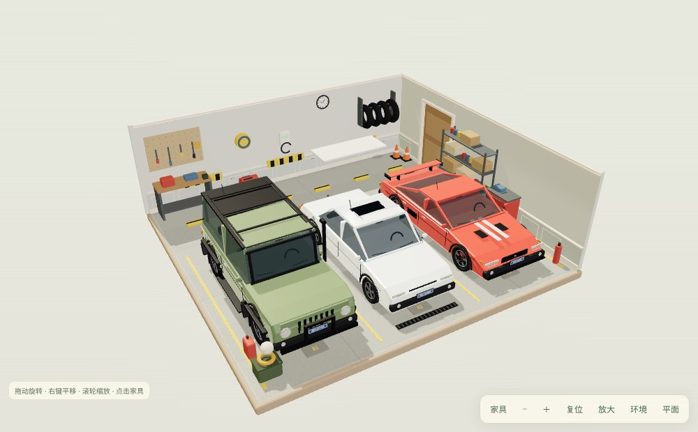
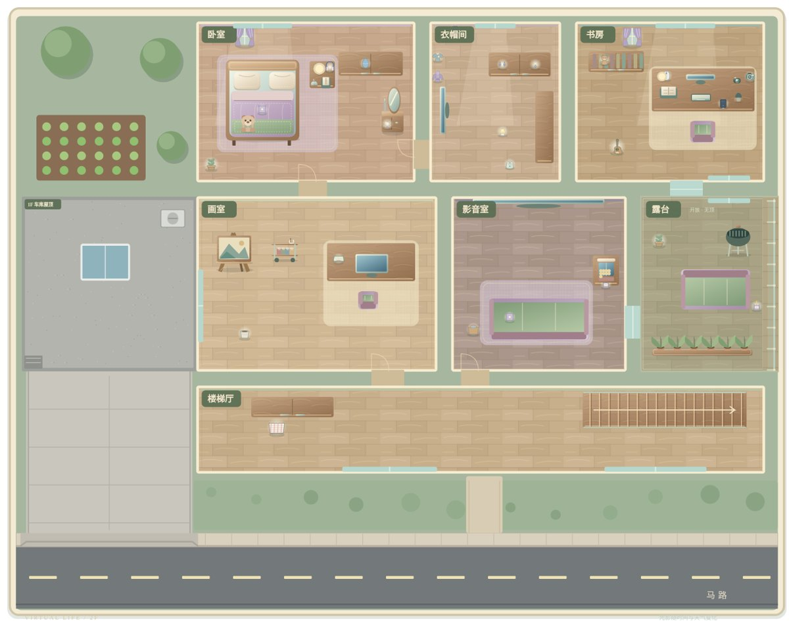
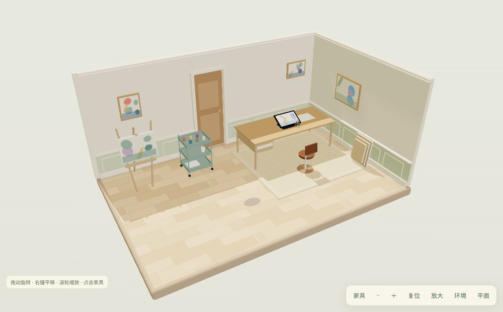

<div align="center">



# 模拟人生_世界

**一个运行在 AstrBot 上的长期生活模拟插件**

她有自己的家、日程、衣柜和车库。你可以走进她的房间，陪她吃饭、看电视、健身、画画、开车兜风，也可以直接和她聊天。

[](metadata.yaml)
[](https://github.com/AstrBotDevs/AstrBot)
[](LICENSE)
[](#-2d--3d-房间)

[功能](#-功能一览) · [预览](#-预览) · [安装](#-快速开始) · [相机](#-相机与绘图模型) · [立绘](#-角色立绘替换) · [指令](#-斜杠指令) · [常见问题](#-常见问题)

</div>

> [!NOTE]
> 市场插件标识：`astrbot_plugin_simlife_world`。
> 从旧标识 `astrbot_plugin_virtual_life` 升级时，如果新数据目录为空，首次启动会**自动复制旧数据**；旧版插件配置需要重新填写。

---

## ✨ 功能一览

<table>
<tr>
<td width="50%" valign="top">

**🏠 两层住宅**
客厅、卧室、书房、厨房、餐厅、浴室、健身室、衣帽间、画室、影音室、露台、阳台、玄关、楼梯厅，外加连着餐厅的车库、车道和门前马路。

**🧊 2D / 3D 房间**
默认 WebGL 3D 视图，可旋转、平移、缩放；一键切回 2D 平面图，设备不支持 WebGL 时自动降级。

**📅 日程与状态**
按人格生成每日日程，向聊天注入当前活动、地点、穿搭和身体状态，回复始终贴合她正在做的事。

**🪑 家具互动**
几乎所有带名字的家具都能点击，2D 近景、3D 房间和物品抽屉三处一致。

</td>
<td width="50%" valign="top">

**🍳 厨房与冰箱**
查看冰箱、生成菜谱、做饭、吃饭、清理和食材管理。

**👗 穿搭与相机**
每日穿搭、换装、观察窗拍照和相册；AI 可以调用 `take_selfie` 主动发自拍。

**🚗 车库与出行**
三台车（白色轿车、吉普、跑车）各自记录油量、状态和行程，出车后车位会空出来；通勤、目的地和载人出行同步写入日程。

**💬 主动消息与记忆**
按概率主动发消息并保持场景一致；可与 LivingMemory 等记忆插件配合保存共同经历。

</td>
</tr>
</table>

## 🖼 预览

<div align="center">



<sub>一楼平面图：车库通过餐厅进屋，车道直通门前马路，玄关楼梯通往二楼</sub>

</div>

<table>
<tr>
<td></td>
<td></td>
</tr>
<tr>
<td align="center"><sub>卧室</sub></td>
<td align="center"><sub>客厅</sub></td>
</tr>
<tr>
<td></td>
<td></td>
</tr>
<tr>
<td align="center"><sub>厨房</sub></td>
<td align="center"><sub>车库</sub></td>
</tr>
</table>

<details>
<summary>更多截图</summary>

<br>


<p align="center"><sub>二楼平面图</sub></p>


<p align="center"><sub>画室</sub></p>

</details>

> 截图中的人物已隐藏。发布包只附带中性占位立绘，请上传你自己的角色图（见[角色立绘替换](#-角色立绘替换)）。

## 🚀 快速开始

**环境要求**

| 项目 | 要求 |
| --- | --- |
| AstrBot | `>= 4.29.3` |
| Python 依赖 | 见 [`requirements.txt`](requirements.txt) |
| 支持平台 | `aiocqhttp` · `telegram` · `wecom` · `lark` · `dingtalk` · `kook` |
| 3D 视图 | 浏览器支持 WebGL（不支持时自动使用 2D） |

**安装步骤**

1. 在 AstrBot 插件市场搜索「模拟人生_世界」安装；或手动把整个目录放进插件目录：

   ```text
   <AstrBot 数据目录>/plugins/astrbot_plugin_simlife_world
   ```

2. 在插件管理页重载插件，或重启 AstrBot。
3. 打开插件配置，填写人格、日程、主动消息、相机等设置。
4. （可选）上传角色立绘 PNG，保存配置后重载插件。

## 🧊 2D / 3D 房间

房间 3D 使用插件内置的 Three.js，不依赖外部 CDN。

| 操作 | 效果 |
| --- | --- |
| 左键拖动 / 方向键 | 旋转房间 |
| 右键拖动 / Shift + 拖动 | 平移 |
| 滚轮 | 缩放 |
| 点击家具 | 打开家具互动 |
| 「家具」按钮 | 家具列表 |
| 「放大」按钮 | 全屏 |
| 「环境」按钮 | 预览不同时间和天气 |
| 「平面」按钮 | 切回 2D 平面视图 |

- 3D 悬停时显示「点击互动 · 名称」，所有显示名称的物体都能点击。
- 没有专用物品记录的装饰会先弹出通用动作，选择后才发起互动。
- 首次打开 3D 需要初始化，低性能设备可能要等几秒；小屏幕建议使用平面视图。

## 📷 相机与绘图模型

拍照已整合进插件，不需要额外安装万象画卷。在插件设置「📷 相机与绘图模型」中填写：

| 设置 | 用途 |
| --- | --- |
| 绘图接口地址 | 兼容 OpenAI `/v1/images/generations` 的接口 |
| 绘图模型 | 如 `moss`，多个模型用英文逗号分隔 |
| 绘图模型设定词 | 画风、质量、构图等通用 prompt |
| 人物 | 人物触发词或角色名 |
| 人物设定词 | 发色、瞳色、服饰和身体特征 |

另有通用负面提示词、人物照 / 房间照尺寸和超时时间。默认使用本机绘图代理，拍照完全由本插件配置的接口生成。

AI 在聊天里想发自拍时会调用 `take_selfie`，生成后直接发到当前聊天。拍照后她会先判断要不要主动回应，主人提到照片时也能自然接上。

## 🧑 角色立绘替换

发布包只保留插件核心代码和中性占位立绘，不附带原始人物立绘。在插件设置「🧑 角色立绘替换」中直接上传 PNG：

| 设置项 | 用途 |
| --- | --- |
| 日常 / 外出立绘 PNG | 日常、外出、2D 和 3D 房间；可多张轮替 |
| 睡衣立绘 PNG | 睡衣/睡前状态；可多张轮替 |
| 头像 PNG | 顶部头像；未上传时跟随日常立绘 |

> [!TIP]
> - 只接受 PNG，建议透明背景、1024×1536 或相同比例；头像建议 512×512。
> - 同一槽位可上传多张，按「立绘轮替间隔」循环使用（默认 86400 秒，最小 30 秒）。
> - 上传后保存配置并重载插件；面板已打开时刷新一次页面。
> - 没有上传或文件损坏时自动使用占位立绘。图片保存在插件数据目录，不会写进安装包。

## 👗 未来穿搭

私聊里明确要求「明天 / 后天穿什么、戴什么」时，插件会通过 `set_future_outfit` 把要求写进未来日程，而不只是在对话里答应：

```text
明天穿雾紫开衫配奶白裙，戴银色鲸鱼耳坠
```

生成当天日程时会一起应用。

## 🪑 家具互动

固定家具支持 2D 近景、3D 房间和物品抽屉点击，具体动作由插件内置数据提供。

## ⌨️ 斜杠指令

命令前缀默认为 `/`，可在 AstrBot 唤醒前缀设置中修改。标注「管理员」的指令需要 AstrBot 管理员权限。直接发送命令组名称可以查看该组帮助：`/虚拟人生`、`/虚拟日程`、`/大时间表`、`/主动消息`。

<details>
<summary><b>/虚拟人生</b>（管理员）· 钱包、商店、物品、好感、报告、读书</summary>

<br>

| 指令 | 说明 |
| --- | --- |
| `/虚拟人生` | 查看子命令帮助 |
| `/虚拟人生 订阅会话` | 订阅当前会话的主动消息 |
| `/虚拟人生 递东西` | 按钮失效时，手动接受最近的递东西动作 |
| `/虚拟人生 清空待处理` | 清空当前人格待处理的递东西动作 |
| `/虚拟人生 钱包` | 查看钱包余额和最近收支 |
| `/虚拟人生 快递` | 查看正在配送的订单 |
| `/虚拟人生 流水` | 查看最近 10 条收支记录 |
| `/虚拟人生 存款目标 <名称> <金额>` | 设置存款目标，例如 `/虚拟人生 存款目标 相机 500` |
| `/虚拟人生 存款` | 查看存款目标进度 |
| `/虚拟人生 商品 [分类]` | 查看商店商品，例如 `/虚拟人生 商品 书籍` |
| `/虚拟人生 物品` | 查看当前拥有的物品 |
| `/虚拟人生 使用 <物品>` | 使用物品，例如 `/虚拟人生 使用 奶茶` |
| `/虚拟人生 摆放 <物品> <房间>` | 摆放物品，例如 `/虚拟人生 摆放 相机 书房` |
| `/虚拟人生 好感` | 查看当前人格与主人的好感度 |
| `/虚拟人生 称呼 <称呼>` | 设置她对主人的称呼，例如 `/虚拟人生 称呼 老板` |
| `/虚拟人生 周报` | 查看最近 7 天生活周报 |
| `/虚拟人生 月报` | 查看最近 30 天生活月报 |
| `/虚拟人生 年总结` | 查看最近一年生活总结 |
| `/虚拟人生 日记` | 查看最近的日记 |
| `/虚拟人生 读书 <书名>` | 让角色读书，例如 `/虚拟人生 读书 云层以下` |
| `/虚拟人生 书架` | 查看书籍和阅读进度 |
| `/虚拟人生 笔记` | 查看读书笔记 |
| `/虚拟人生 给钱 <金额>` | 给当前人格一笔钱，例如 `/虚拟人生 给钱 100` |
| `/虚拟人生 测试按钮` | 创建测试用待处理按钮 |
| `/虚拟人生 自检` | 查看当前会话的隐私与主动消息配置 |

</details>

<details>
<summary><b>/虚拟日程</b> · 日程、穿搭、菜单、旅行</summary>

<br>

`查看`、`穿搭`、`菜单` 和 `旅行` 仅私聊可用。

| 指令 | 权限 | 说明 |
| --- | --- | --- |
| `/虚拟日程` | 所有人 | 查看子命令帮助 |
| `/虚拟日程 查看` | 所有人 | 查看今日日程时间轴图片 |
| `/虚拟日程 穿搭` | 所有人 | 查看今日穿搭图片 |
| `/虚拟日程 菜单` | 所有人 | 查看今日菜品、做饭 / 外食安排和采购清单 |
| `/虚拟日程 旅行` | 所有人 | 查看当前或下一趟旅行 |
| `/虚拟日程 旅行 规划 <目的地> [日期] [天数]` | 管理员 | 规划旅行 |
| `/虚拟日程 旅行 取消` | 管理员 | 取消旅行 |
| `/虚拟日程 要求 <日期范围> <要求>` | 管理员 | 为未来日期的首次日程生成添加要求 |
| `/虚拟日程 重写 [额外要求]` | 管理员 | 重新生成今日日程和穿搭 |
| `/虚拟日程 重写日程 [额外要求]` | 管理员 | 只重新生成今日日程 |
| `/虚拟日程 重写穿搭 [额外要求]` | 管理员 | 只重新生成今日穿搭 |

</details>

<details>
<summary><b>/大时间表</b>（管理员）· 长期阶段草稿</summary>

<br>

| 指令 | 说明 |
| --- | --- |
| `/大时间表` | 查看子命令帮助 |
| `/大时间表 生成 [要求]` | 根据自然语言要求生成追加草稿 |
| `/大时间表 导入 <JSON>` | 导入结构化 JSON，作为替换全部阶段的草稿 |
| `/大时间表 草稿` | 查看当前人格待批准草稿 |
| `/大时间表 批准` | 批准草稿并重新生成今日日程 |
| `/大时间表 拒绝 [修改意见]` | 拒绝草稿；提供修改意见时重新生成 |
| `/大时间表 列表` | 查看全部已批准阶段 |
| `/大时间表 查看 [阶段ID/名称/片段]` | 查看指定阶段，省略参数时查看当前阶段 |
| `/大时间表 重生成 [要求]` | 重新生成替换全部阶段的草稿 |

</details>

<details>
<summary><b>/主动消息</b> · 状态与触发</summary>

<br>

| 指令 | 权限 | 说明 |
| --- | --- | --- |
| `/主动消息` | 所有人 | 查看子命令帮助 |
| `/主动消息 状态` | 所有人 | 查看当前会话的主动消息状态 |
| `/主动消息 立即` | 管理员 | 立即触发一次主动消息 |
| `/主动消息 执行时间` | 所有人 | 查看今日已安排的主动消息执行时间 |

</details>

<details>
<summary><b>/回复延迟</b>（管理员）· 回复批次</summary>

<br>

| 指令 | 说明 |
| --- | --- |
| `/回复延迟 开启` | 开启回复延迟批次 |
| `/回复延迟 关闭` | 关闭回复延迟并立即结算等待批次 |
| `/回复延迟 结算` | 立即结算当前会话的等待批次 |

</details>

> 指令以当前版本为准；后续调整时，以各命令组的实际帮助输出为准。

## 📁 数据与目录

**运行数据**

```text
<AstrBot 数据目录>/plugin_data/astrbot_plugin_simlife_world
```

| 内容 | 说明 |
| --- | --- |
| `plans.json` | 每日日程 |
| `personas.json` | 人格配置 |
| `interactions/` | 观察窗互动记录 |
| 其他 | 照片、日记、家具状态、自定义立绘等 |

> [!IMPORTANT]
> 升级或迁移插件时请保留该数据目录。

**插件结构**

```text
astrbot_plugin_simlife_world/
├─ main.py                 插件入口
├─ metadata.yaml           插件元数据
├─ _conf_schema.json       配置项定义
├─ requirements.txt        Python 依赖
├─ core/                   日程、人格、家具、厨房、相机、出行等逻辑
├─ templates/              图片渲染模板
└─ views/life/             生活面板
   ├─ index.html
   ├─ app.js
   ├─ style.css
   └─ assets/              2D 房间、3D 模型、家具、目的地、车辆素材
```

## ❓ 常见问题

<details>
<summary>3D 视图一直是平面图？</summary>

浏览器可能禁用了 WebGL，或显卡驱动不支持。插件会自动回退到 2D，其他功能不受影响。可以在浏览器设置里开启硬件加速后重试。

</details>

<details>
<summary>换了立绘但面板没变化？</summary>

保存插件配置后重载插件，再刷新一次面板页面。之后再换图会自动刷新房间。

</details>

<details>
<summary>从旧版 virtual_life 升级，数据还在吗？</summary>

在新插件的数据目录为空时，首次启动会自动复制 `plugin_data/astrbot_plugin_virtual_life` 到新目录。插件配置不会复制，需要重新填写。

</details>

<details>
<summary>改了前端文件但没生效？</summary>

修改 `views/life` 下的文件后，更新 `index.html` 里对应资源的 `?v=` 版本号，然后强制刷新页面。

</details>

## 📜 来源与许可证

本项目基于 [FloranceYeh/astrbot_plugin_virtual_life](https://github.com/FloranceYeh/astrbot_plugin_virtual_life)（GPL-3.0）继续开发，保留原项目的版权与许可声明。

本项目以 **GNU General Public License v3.0** 发布，完整文本见 [LICENSE](LICENSE)。

<div align="center">
<sub>Made with 💜 for AstrBot</sub>
</div>
